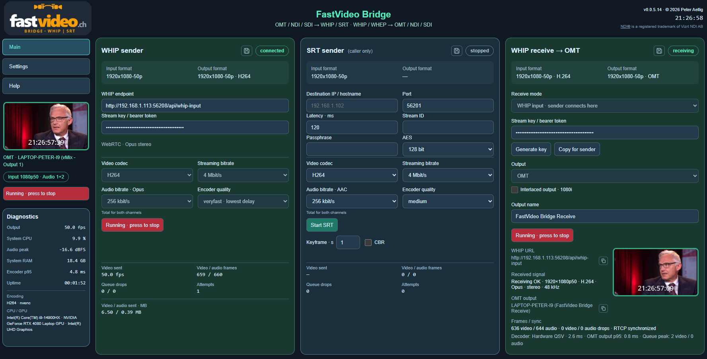

# FastVideo WHIP Bridge

**Website and Bridge overview: [fastvideo.ch](https://fastvideo.ch/)**

FastVideo Bridge is a standalone live-video sender and receiver for Windows. It connects OMT, NDI and Blackmagic SDI with WHIP, WHEP and SRT, controlled through a local web interface.

**[Download the Windows installer (version 0.0.5.14)](https://github.com/peteraellig/FastVideoBridge/releases/download/v0.0.5.14/FastVideoBridge-Setup-0.0.5.14-lean.exe)** · [All releases](https://github.com/peteraellig/FastVideoBridge/releases)



## Features

- OMT, NDI and Blackmagic SDI video inputs and outputs.
- WHIP sending with H.264, H.265* or AV1* video and Opus audio. (*AV1 or H.265 may not be supported, depending on the graphics card used)
- Two audio tracks are transmitted. If your source signal has more than two audio tracks, you can specify in the setup which two of the eight audio tracks from SDI/OMT or NDI should be included. (1&2, 3&4, 5&6, 7&8, 1–8)
- SRT sending in caller mode with H.264/H.265* video and AAC audio.
- WHIP reception
- Playback of FastVideo links through WHEP.
- Output of received signals through OMT, NDI or Blackmagic SDI.
- Hardware acceleration depending on the codec, graphics hardware and drivers.
- Live previews, audio selection and diagnostics in the web interface.

## Installation

1. Download and run the [Windows installer](https://github.com/peteraellig/FastVideoBridge/releases/download/v0.0.5.14/FastVideoBridge-Setup-0.0.5.14-lean.exe).
2. Launch FastVideo Bridge using the shortcut created by the installer.
3. The control interface opens at [http://127.0.0.1:18879/sender](http://127.0.0.1:18879/sender).
4. Configure your source, destination or receiver and start streaming. Use the **Stop FastVideo Bridge** shortcut to shut down the application.

Windows x64 is required. The installer includes Python, the Go media gateway and the OMT runtime. For NDI input or output, install [NDI Tools](https://ndi.video/tools/) separately. Blackmagic SDI requires Blackmagic Desktop Video. Up-to-date graphics drivers are recommended.

For incoming WHIP traffic, configure the selected receiving port and router port forwarding if needed. See the Bridge's built-in help for details. WHEP reception uses an outgoing connection.

A [SHA-256 checksum](https://github.com/peteraellig/FastVideoBridge/releases/download/v0.0.5.14/FastVideoBridge-Setup-0.0.5.14-lean.exe.sha256) is included with the release. The prebuilt installer is provided as a release asset and is not included in the Git source archive.

## Build from source

Install Python 3.12 x64 and Go 1.26 or newer. Run the following commands in PowerShell from the project directory:

```powershell
py -3.12 -m venv .venv
.\.venv\Scripts\python.exe -m pip install -r documents\requirements.lock.txt
Copy-Item fastvideo.settings.example.json fastvideo.settings.json
Push-Location gateway
go build -mod=vendor -trimpath -o fastvideo-gateway.exe .
Pop-Location
.\Start-Bridge.bat
```

Do not overwrite an existing personal configuration. See [BUILD.txt](BUILD.txt) for additional instructions on creating a Windows installer.

`gateway/vendor` contains the required Go libraries, including a local GoSRT patch. Keep this directory when building. `vendor/omt` contains the required native OMT libraries and their license.

## Documentation

- [Website and Bridge overview](https://fastvideo.ch/)
- [Build instructions](BUILD.txt)
- [Python dependencies](documents/requirements.txt) and [pinned versions](documents/requirements.lock.txt)

The documents directory contains only the dependency lists needed to build the application.

## License

The project's own FastVideo Bridge code is licensed under the **BSD Zero Clause License (0BSD)**. See [LICENSE](LICENSE).

Bundled third-party components retain their respective licenses. License texts can be found in `gateway/vendor`, `gateway/third_party_licenses` and `vendor/omt/LICENSE.txt`. The Windows installer includes additional license texts alongside its bundled runtime components.

NDI® is a registered trademark of Vizrt NDI AB.
